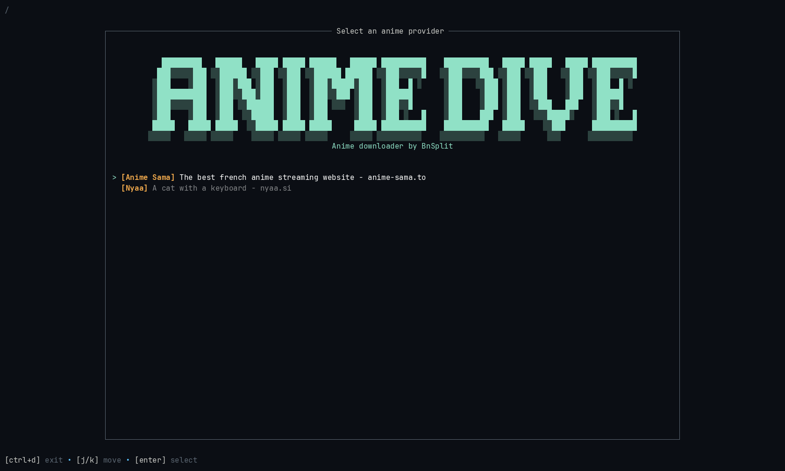

# AniDive

A TUI anime downloader for Linux



## Features

- [AnimeSama](https://anime-sama.to): search, seasons, languages, and episode selection
- [Nyaa](https://nyaa.si): torrent search, pagination, and magnet downloads
- Downloads saved to `~/AniDive`

## Installation

### Option 1: Using my Arch Linux Repository

**Set up the bn-arch-repo:**
  Follow the instructions at [bnsplits/bn-arch-repo](https://github.com/bnsplits/bn-arch-repo)

**Install anidive:**

  ```bash
  sudo pacman -S anidive
  ```

### Option 2: Manual Installation

**Requirements**

- `rust`
- `aria2c`
- `yt-dlp`
- `ffmpeg`
- `xdg-open`

**Install anidive:**

```sh
cargo install --path .
```
